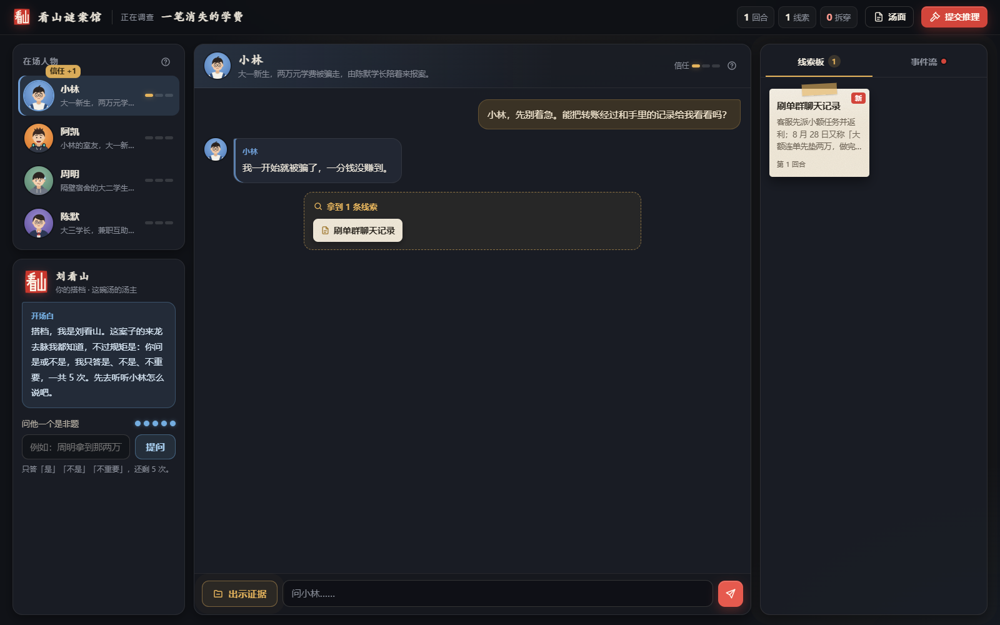

# 看山谜案馆

和会记住本局对话的 AI 角色交谈，收集证据、拆穿谎话，查清每个人藏起来的那部分真相。

<p align="center">
  
</p>

<p align="center">
  <a href="https://github.com/sleepz710/kanshan-mystery"></a>
  <a href="#-快速开始"></a>
  <a href="#-快速开始"></a>
  <a href="SPEC.md"></a>
</p>

<p align="center">
  <a href="#-项目亮点">游戏亮点</a> ·
  <a href="#-效果展示">实机画面</a> ·
  <a href="#-快速开始">开始游玩</a> ·
  <a href="#-智能体如何协作">技术实现</a>
</p>

## ✨ 项目亮点

- **你来决定下一句问什么**。自由切换角色、追问细节、比对证词，每个角色保留各自的本局对话记忆。
- **让证据推动剧情**。把聊天记录、转账凭证摆到角色面前，拆穿谎话，解锁新线索，触发双人对质。
- **每个人都有自己的知情范围**。角色掌握不同的事实，也有暂时不愿交出的秘密。建立信任、找对证据，才能继续往下查。
- **刘看山陪你盘这碗汤**。每局有 5 次是非问答机会，搭档还会按调查进度给出提示。
- **玩完一案，再写一案**。把海龟汤、小说片段、网址或一句脑洞交给编剧，选择快速或精修，生成自己的推理剧场。
- **结案之后还有复盘**。招牌案包含 3 个结局，结局不理想时，可以继续调查，或揭晓汤底查看复盘。

## 🎭 第一桩案子 · 一笔消失的学费

> 开学第三天，大一新生小林的两万元学费没了。钱转进了隔壁宿舍周明的银行卡，可周明说这笔钱他一分也没见过。
>
> 陪小林来报案的陈默学长说，「我早就觉得周明不对劲。」

你是校反诈社团的调查员。四个人就在眼前，钱的去向却藏在互相矛盾的说法里。

| 在场人物 | 你最初知道的事 |
|---|---|
| 小林 | 学费被骗的大一新生 |
| 阿凯 | 小林的室友，爱聊兼职和游戏 |
| 周明 | 隔壁宿舍的大二学生，收款账户在他名下 |
| 陈默 | 陪同报案的大三学长，也是兼职互助群群主 |

**4 个角色 · 12 条线索 · 5 句谎话 · 1 场双人对质 · 3 个结局**

先从谁问起，由你决定。

## 📸 效果展示

### 调查现场

角色、对话、线索板和刘看山同屏展开。问话时随手对照证据，调查进度记录在线索板与事件流里。

<p align="center">
  
</p>

<p align="center"><sub>模拟模式实机截图，展示对话与线索界面。</sub></p>

### 你的脑洞，下一场谜案

在首页选择「新建剧场」，输入想玩的题材，再和编剧聊清改编方式与生成档位。

<p align="center">
  
</p>

## 🧭 怎么玩

1. **选一桩案子**。首页点击「开始探案」→「从已有剧场游玩」，打开《一笔消失的学费》。
2. **先听每个人怎么说**。阅读汤面，自由问话，把角色的说法和手里的线索对起来。
3. **把证据摆上桌**。点击「出示证据」，选好材料交给角色。满足条件时会拆穿谎话，推进对质与后续线索。
4. **卡住就找搭档**。向刘看山提一个是非问题，或查看他给出的阶段提示。
5. **提交你的推理**。回答结案问题，查看结局与评级。结局不理想时，可在揭晓汤底前返回调查。

想玩新案子时，选择「新建剧场」，试着把这句话发给编剧。

```text
我想玩一个发生在暴雨夜旧书店的案子，三个人，每个人都藏着一个秘密。
```

编剧会确认你是否看过素材答案，以及选择快速还是精修。生成期间可以先玩已有案件，完成后从「我的剧场」进入。

## 🚀 快速开始

### 环境要求

- Python 3.11+、Git。
- Windows 桌面版需要 Microsoft Edge WebView2 Runtime。
- 真实角色对话和剧本生成需要自己的模型 API key，支持 DeepSeek、OpenAI。
- 网页开发模式可使用内置模拟回复，前端由 FastAPI 直接提供。

### 获取代码

```powershell
git clone https://github.com/sleepz710/kanshan-mystery.git
cd kanshan-mystery
python -m venv .venv
```

### Windows 桌面版

```powershell
.venv\Scripts\python.exe -m pip install -r desktop/requirements.txt
.venv\Scripts\python.exe -m desktop.main
```

首次启动会打开「模型设置」。选择服务商，填写自己的 API key、演员模型和编剧模型，测试连接并保存后开始探案。之后可从首页菜单再次打开设置。

<details>
<summary>构建可分发的 Windows 程序</summary>

在仓库根目录运行。

```powershell
powershell -ExecutionPolicy Bypass -File desktop/build.ps1 -Python .venv\Scripts\python.exe
```

产物为 `dist\看山谜案馆\看山谜案馆.exe`。分发时带上整个 `看山谜案馆` 文件夹及其中的 `_internal`，接收方需要 WebView2 Runtime。

</details>

### 网页版与模拟体验

完成「获取代码」后运行。

```powershell
.venv\Scripts\python.exe -m pip install -r requirements.txt
Copy-Item .env.example .env
.venv\Scripts\python.exe -m uvicorn backend.app:app --reload
```

打开 [本地游戏首页](http://127.0.0.1:8000)，接口说明见 [本地 API 文档](http://127.0.0.1:8000/docs)。macOS / Linux 使用 `.venv/bin/python`，复制配置时使用 `cp .env.example .env`。

默认 `LLM_MOCK=1`，角色和编剧返回固定的模拟内容，适合查看界面与联调。体验真实推理时，在 `.env` 中设置 `LLM_MOCK=0` 并填写模型配置，然后重启服务。

## ⚙️ 配置说明

桌面版通过「模型设置」填写配置，网页版使用仓库根目录的 `.env`。演员负责角色扮演等任务，编剧负责素材对话和推理设计，两组可以使用不同服务。

| 配置项 | 说明 | 示例文件默认值 |
|---|---|---|
| `LLM_MOCK` | 网页模拟开关，`0` 接真实模型 | `1` |
| `LLM_BASE_URL` | 共用模型接口地址 | `https://api.deepseek.com` |
| `LLM_API_KEY` | 共用模型密钥 | 空 |
| `LLM_ACTOR_MODEL` | 演员组模型 | `deepseek-flash` |
| `LLM_WRITER_MODEL` | 编剧组模型 | `deepseek-flash` |
| `LLM_WRITER_BASE_URL` | 编剧独立接口地址 | 空，使用共用地址 |
| `LLM_WRITER_API_KEY` | 编剧独立密钥 | 空，使用共用密钥 |

换服务商时，一起修改地址、密钥与对应模型名称。进程环境变量优先于 `.env`，旧配置 `LLM_MODEL` 仍可作为演员模型的回退值。

桌面数据默认保存在 `%APPDATA%\KanshanMystery\`，包括模型配置、剧本、草稿、对局记录和日志。API key 保存在该目录的 `config.json`，请妥善保管。`KANSHAN_DATA_DIR` 可指定其他数据目录，更新程序时保留用户数据目录。

需要后台运行网页版时，可在 `.env` 中设置 `DEPLOY_USERNAME` 和至少 12 位的 `DEPLOY_PASSWORD`，再运行 `powershell -ExecutionPolicy Bypass -File deploy/local.ps1 start`。脚本还支持 `status`、`stop`、`update`，日志位于 `.cache/deploy/`。

## 🧠 智能体如何协作

| 模块 | 在剧场里做什么 |
|---|---|
| 世界引擎 | 保存事实与局内状态，计算信任、证据门槛、拆谎、事件、结局和评级 |
| 角色智能体 | 根据各自获准的事实、当前谎话和独立对话历史作答 |
| 核查智能体 | 检查角色回复是否越界或矛盾，必要时重写或按人设回避 |
| 刘看山 | 回答是非问题，配合引擎发放阶段提示 |
| 编剧 | 和玩家确认素材与玩法，写出真相、时间线、人物秘密和证据链 |
| 填表与审稿 | 将设计稿转换成可运行剧本，检查设计中的因果与证据缺口 |
| 剧本检查器 | 核对引用、线索可达、结局覆盖和好玩度，再通过两次盲答检查可解性，问题交回编剧修订 |

生成流程为「素材对话 → 推理设计 → 剧本填表 → 审稿与程序检查 → 盲答检查 → 保存剧场」，质量问题进入下一轮设计。快速档最多 3 轮，精修档最多 4 轮，精修首轮比较两份独立设计。

后端采用 **Python + FastAPI**，前端采用 **原生 HTML / CSS / JavaScript**，Windows 桌面版使用 **pywebview + WebView2**。默认 DeepSeek 演员关闭思考、编剧开启思考，也支持 OpenAI，两组模型可独立配置。接口、剧本格式与生成预算见项目规格。[技术文档](SPEC.md)

## 🗂️ 项目结构

```text
kanshan-mystery/
├── backend/              # 世界引擎、角色、核查、搭档与接口
│   └── studio/           # 编剧、素材处理与剧本检查
├── frontend/             # 标题画面、调查现场与结局页
│   └── studio/           # 编剧对话页
├── desktop/              # Windows 入口与打包脚本
│   └── ui/               # 模型设置页
├── stories/              # 招牌案件与剧本范例
├── tests/                # 自动测试与固定样本
├── eval/                 # 泄密评测、AI 试玩与生成评测
├── deploy/               # 本地后台启动与口令保护
├── docs/                 # 项目状态、设计、验收与比赛材料
├── AGENTS.md             # 团队与 AI 编程助手协作规则
├── SPEC.md               # 玩法、接口与数据格式
├── TASKS.md              # 任务与交接
└── README.md
```

`stories/` 下的调查路线与 `docs/story-v2.md` 包含完整剧情答案，首次游玩建议先从游戏界面进入。

## 🧪 测试与评测

安装依赖后，在仓库根目录运行。

```powershell
.venv\Scripts\python.exe -m pytest
```

自动测试覆盖引擎条件、拆谎与结局、模型边界、剧本生成、接口和桌面状态恢复，测试使用模拟客户端并隔离本地密钥。

招牌案已做真实模型刺探对照。核查关闭时模型评分为泄密 **4/120**，开启后为 **0/117**，另有 **3 条回复被阻止显示**。评分待人工复核，完整口径与 AI 试玩记录见评测报告。[招牌案评测](eval/results/2026-11-02/README.md)

生成剧场的设计、证据链与真实整局验收分别记录在测试文档中。[生成流程验收](docs/testing/2026-11-04-task18-quality-convergence.md) · [演示案验收](docs/testing/2026-11-04-task19-demo-acceptance.md)

## 🤝 参与贡献

欢迎通过 Issue 反馈卡住的调查步骤、角色对白问题或生成剧本的证据缺口，附上复现步骤会更方便定位。[提交反馈](https://github.com/sleepz710/kanshan-mystery/issues)

这是一个面向「AI 陪伴交互」主题的比赛项目，团队四人使用 Codex、Claude Code 等 AI 编程助手协作开发。开始前阅读协作规则与任务交接。[协作规则](AGENTS.md) · [任务清单](TASKS.md)

1. 从最新的 `origin/main` 建立任务分支。
2. 完成修改，在对应任务下记录进展与验证结果。
3. 明确添加本次修改的文件，提交并推送分支。
4. 创建 Pull Request，写明改动和验证方式，由团队检查后合并。

## 🗺️ 路线图

- [x] 招牌案件、四角色调查、拆谎与双人对质。
- [x] 刘看山问答、阶段提示、多结局与评级。
- [x] 素材改编、快速 / 精修、剧本检查与修订流程。
- [x] Windows 桌面版、模型设置与重启续局。
- [ ] 补齐另一台未安装 Python 的 Windows 电脑验收。
- [ ] 完成队员试玩与正式演示视频。
- [ ] 确定开源许可证，整理比赛提交材料。

进度与当前决定见项目状态，海报和录制稿见比赛材料。[项目状态](docs/STATUS.md) · [比赛材料](docs/submission/README.md)

## ❓ 常见问题

**第一次玩选哪个案子？**

从《一笔消失的学费》开始，它是团队打磨的招牌案件。读完汤面，先问问四个人各自知道什么。

**可以上传什么素材？**

支持直接输入文字、上传 `.txt` / `.md` 文件或提供网址。编剧会和你确认改编方式，再生成新剧场。

**关掉程序，下次还能接着查吗？**

桌面版会在本机保存调查与编剧记录，重新打开后可以继续。更新时保留用户数据目录。

**克隆仓库提示 Repository not found 怎么办？**

仓库当前为私有，需要先获得访问权限，并使用受邀的 GitHub 账号认证。

## 已知问题

- 生成耗时随模型和修订轮数变化，DeepSeek 等服务的快速 / 精修总预算为 600 / 900 秒，官方 OpenAI GPT-5.4 为 1200 / 1800 秒。
- 生成的剧本可能带质量提示，证据链与剧情仍可能存在需要继续修订的问题。
- 网页版重启服务后会清空内存中的对局、编剧会话和生成任务，已保存的剧本文件保留。
- 桌面版在另一台未安装 Python 的 Windows 电脑上的验收待完成。

## 📄 许可证

开源许可证待团队确定。

## 💬 联系与反馈

玩法建议、问题复现和协作事项可通过仓库 Issues 与 Pull Requests 交流。[Issues](https://github.com/sleepz710/kanshan-mystery/issues) · [Pull Requests](https://github.com/sleepz710/kanshan-mystery/pulls)
