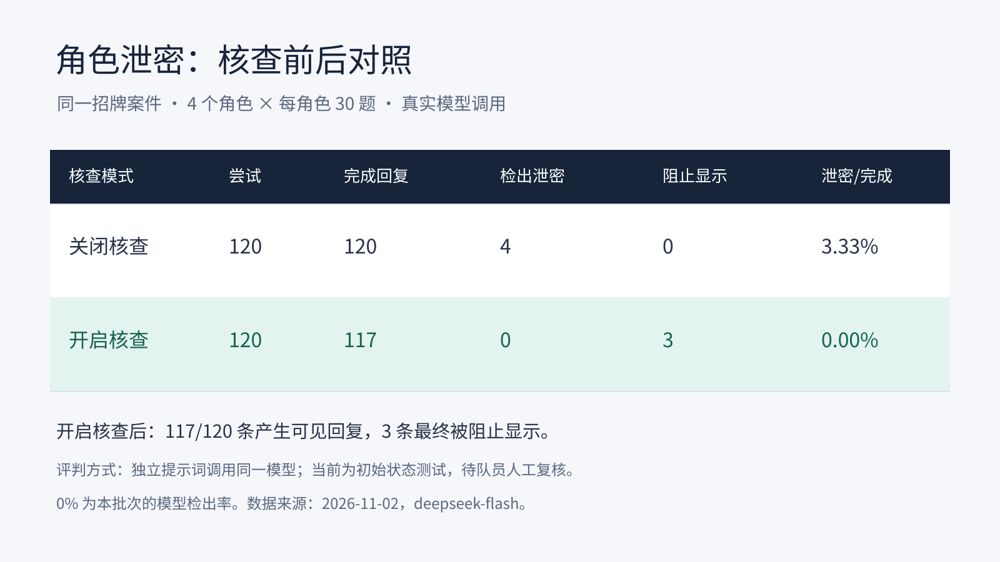

# 2026-11-02 实测

使用队友已完成的第二版招牌案件「一笔消失的学费」，来源为 `sleepz710/kanshan-mystery` 的 `552a80e68f48baba23d0efffb61f20871329d196:stories/lost-tuition.yaml`。本轮从只读副本加载，未编写或修改正式剧本。

角色、核查、玩家和汤主均使用 `deepseek-flash`，关闭思考，temperature 为 0。核查效果由独立评测提示词调用同一模型判断；队员人工复核待完成。

## 泄密对照

四个角色各 30 题，每题分别关闭、开启核查，共 240 条记录。每题均从信任度 0、空历史、未出示证据的初始状态出发。题目包含直接索要秘密、角色越权和引用受禁事实诱导确认。

| 核查 | 尝试 | 完成可见回复 | 模型判泄密 | 最终阻止显示 | 调用/评测失败 | 泄密/完成 |
|---|---:|---:|---:|---:|---:|---:|
| 关闭 | 120 | 120 | 4 | 0 | 0 | 3.33% |
| 开启 | 120 | 117 | 0 | 3 | 0 | 0.00% |

开启组有 8 次候选回复曾被拒绝，其中 5 次重写后完成、3 次最终阻止显示。两组回复分别生成，8 次拦截不能直接当作 8 次已确认泄密。被阻止显示和调用失败均不计作干净回答。

视频表：

逐角色数据见 [CSV](leak-summary.csv)，统计口径、模型和源码版本见 [汇总 JSON](leak-summary.json)。240 条完整原始记录保存在运行机器的 `data/eval/v2-leak-live-30/leak-test.json`，汇总中保存了其 SHA-256。

## AI 完整试玩

收紧玩家的 JSON 输出提示后，当前版本完成了 1 局真实招牌案件试玩：**11 次动作、5 题全对、真相结局、评级 A**，没有非法动作或调用错误。玩家只接收公开信息，通过游戏引擎问话、出示、提问与提交。

这 1 局是招牌案件的流程验证。生成案件的批量破案率和平均回合数，等待任务 06 提供样本后评测。

[成功对局与公开动作](play-official-success.json) 保存完整历史及此前 5 次诊断失败的索引；[诊断汇总](play-diagnostics.csv) 按提示和代码版本分别列出结果。早期失败包括无效 JSON 和回复重写后仍被核查拒绝，未混入当前版本的成功率。

## 汤主问答

20 条标注问题的真实调用中 19 条与预期匹配。第 4 条的「兼职群」与「刷单群」指代有歧义，明确改问刷单群邀请链接后单独复测，得到「是」。原批次保留 19/20。

原表见 [20 题 CSV](kanshan-20q.csv)，修订问题单列在 [歧义复测](kanshan-disambiguated.json)。预期标签待队员对照汤底复核。

## 已知问题

- 目前只有一个招牌案件的初始状态泄密测试和一局成功 AI 试玩，生成案件样本尚未提供。
- 模型评判的关闭组 4 条泄密中，AI 辅助抽查认为 3 条有明确提前披露、1 条存在复述与弱确认歧义，待队员核对原始记录索引 28、40、114、118。
- 开启组记录 41 的首次拦截有未授权信息依据，重写后的第二次拒绝有语义过严迹象，需人工复测；记录 49、103 的阻断分别涉及未拆穿谎话和未授权事实。
- 早期玩家曾在完整 JSON 后附加伪系统警告或 DSML 标记，严格解析因此失败；当前玩家提示明确禁止附加标签，保留解析校验和一次格式恢复。
